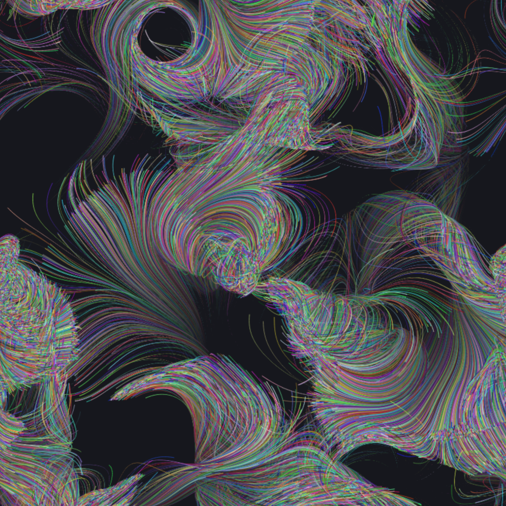

# Simplex Noise Flow Field

Simplex Noise Flow Field generates random, varying flow-field animations based on simplex noise.  
Start date: 2026-11-03  

## Demo

## Installation

Open the repository with the editor of your choice, or skip installation altogether by visiting [the deployed version](https://anderjef.github.io/simplex-noise-flow-field/).

## Usage

1. You can visit the production build at <https://anderjef.github.io/simplex-noise-flow-field/>, or render [index.html](index.html) in your own editor.

## Deployment

<https://anderjef.github.io/simplex-noise-flow-field/> is continuously deployed to via a GitHub Action workflow.

## Acknowledgements

- Inspired by [a video on YouTube](https://www.youtube.com/watch?v=BjoM9oKOAKY).

## Author

- **Jeffrey Andersen** &mdash; [GitHub Profile](https://github.com/anderjef) &bull; [Website](https://anderjef.github.io)

## License

For copyright, license, and warranty, see [LICENSE.md](LICENSE.md).
